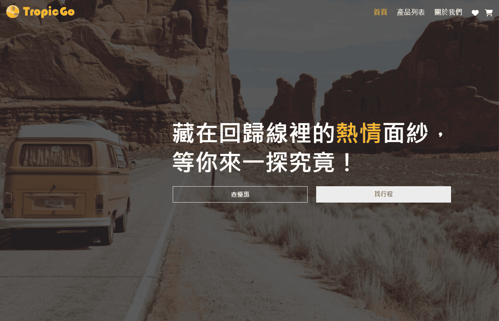
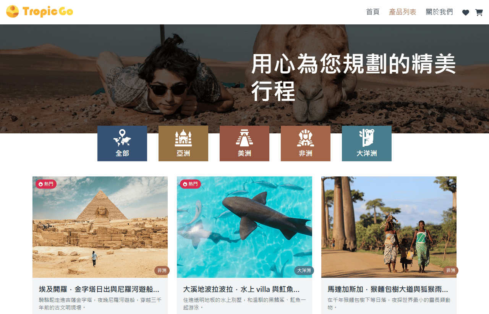
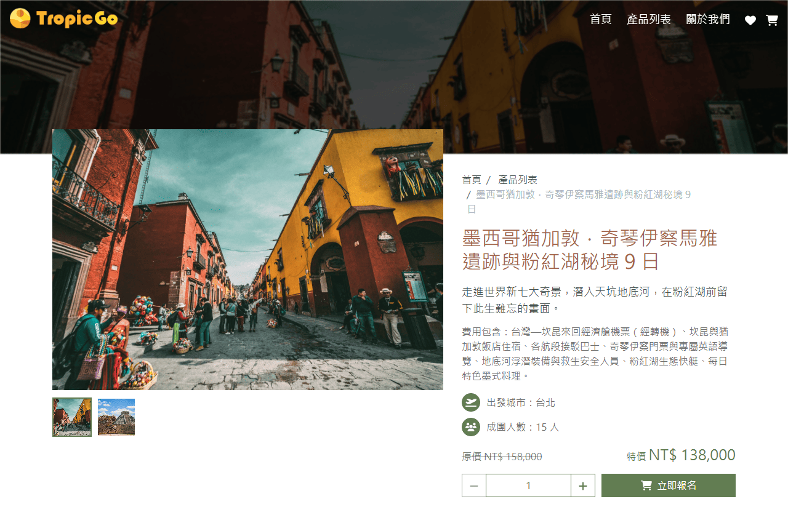
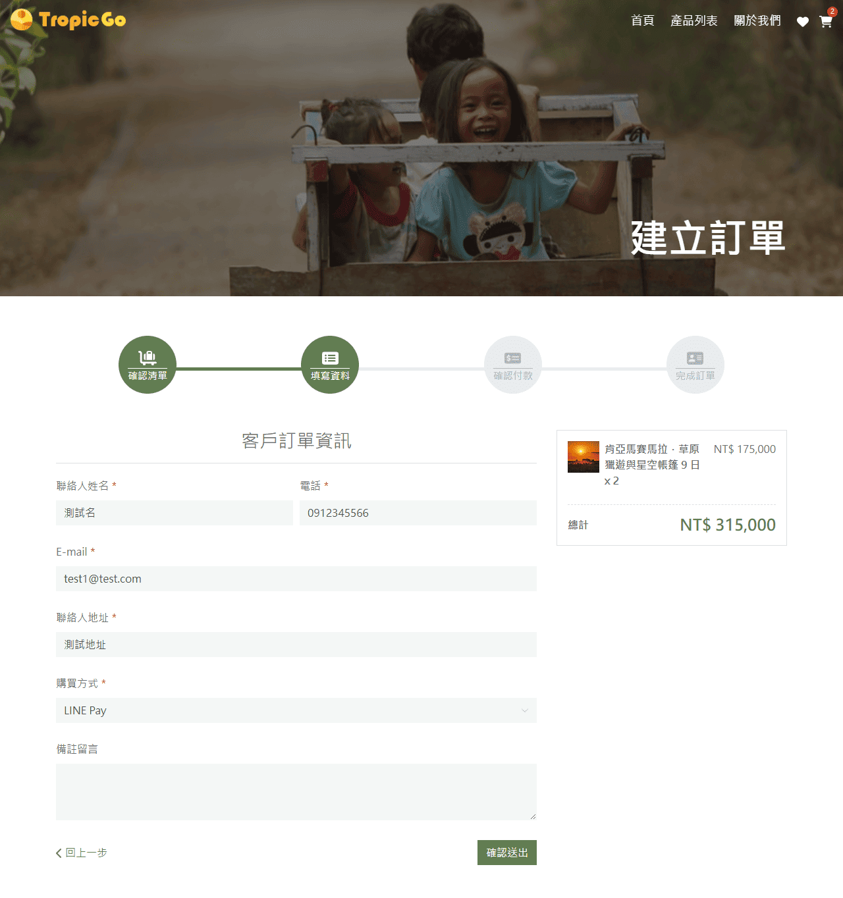
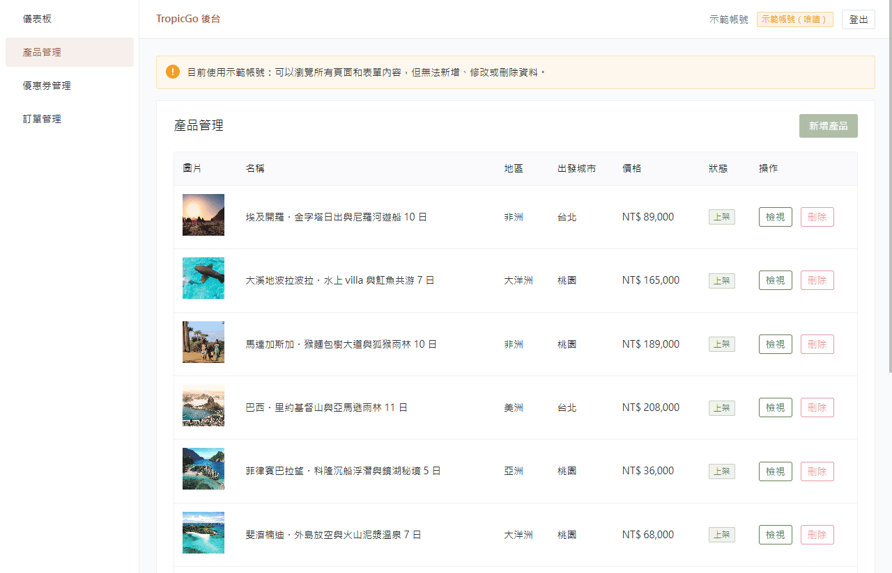
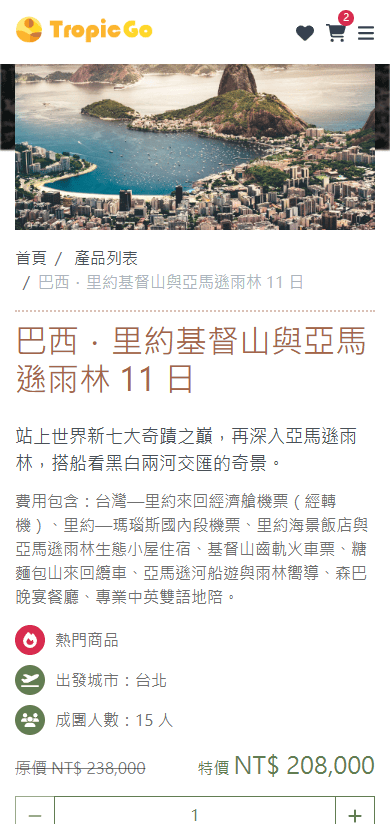

# TropicGo 熱趣

熱帶旅遊電商網站，包含前台購物流程與後台管理系統。

前身是純前端的 Vue 2 練習作品（[v1.0](https://github.com/chloelo/TropicGo/tree/v1.0)），原本串接的第三方課程 API 已下架。v2 保留原本的視覺設計，改寫成前後端分離的全端專案：自己設計資料庫與 API，並部署到雲端。

## 線上網址

| 項目 | 網址 |
| --- | --- |
| 前台 | https://tropicgo.vercel.app |
| 後台 | https://tropicgo.vercel.app/admin/login |
| API 文件（Swagger UI） | https://tropicgo-api.onrender.com/api-docs/ |
| v1 舊版 | https://chloelo.github.io/TropicGo/ |

> 後端使用 Render 免費方案，閒置一段時間後會休眠，第一次開啟可能要等數十秒。

### 示範帳號

後台登入頁按「使用示範帳號登入」即可進入。示範帳號可以瀏覽所有後台頁面，但不能新增、修改或刪除資料。

前台結帳可使用優惠碼 `tropicgo90`（全站 9 折）。

## 截圖

<table>
  <tr>
    <th>首頁</th>
    <th>產品列表</th>
  </tr>
  <tr>
    <td></td>
    <td></td>
  </tr>
  <tr>
    <th>產品詳情</th>
    <th>結帳：填寫資料</th>
  </tr>
  <tr>
    <td></td>
    <td></td>
  </tr>
</table>

<table>
  <tr>
    <th>後台（示範帳號，唯讀）</th>
    <th>手機版</th>
  </tr>
  <tr>
    <td width="75%"></td>
    <td width="25%" align="center"></td>
  </tr>
</table>

## 功能

**前台**

- 產品列表（依地區篩選）、產品詳情、相關產品推薦
- 我的收藏（存在瀏覽器，不需登入）
- 購物車與結帳流程：購物車 → 填寫資料 → 確認訂單並付款（模擬）→ 完成，可使用優惠碼
- 未付款的訂單會記在瀏覽器，可從購物車選單繼續付款
- RWD，支援手機與桌機

**後台**

- JWT 登入，token 過期自動導回登入頁，登入後回到原本的頁面
- 產品管理、優惠券管理（新增、編輯、刪除）
- 訂單管理（查看訂單、更新訂單狀態）
- 兩種角色：管理員（完整權限）、示範帳號（唯讀，後端也會擋下寫入請求）

## v1 → v2

| | v1 | v2 |
| --- | --- | --- |
| 前端 | Vue 2、Vue CLI、JavaScript | Vue 3、Vite、TypeScript |
| 樣式 | Bootstrap 4、SCSS | UnoCSS、Naive UI |
| 後端 | 第三方課程 API（已下架） | 自行開發 Express API |
| 資料庫 | 無 | PostgreSQL |
| 部署 | GitHub Pages | Vercel、Render（Docker）、Neon |

## 使用技術

**前端**

- Vue 3（Composition API、`<script setup>`）+ Vite + TypeScript
- Pinia：購物車、後台登入狀態
- Vue Router：前後台路由、登入驗證
- Naive UI：後台介面、表單驗證
- UnoCSS：utility-first 樣式
- Axios：API client 由 OpenAPI 規格自動產生，請求與回應都有型別

**後端**

- Node.js + Express 5
- TypeORM + PostgreSQL，資料表結構以 migration 管理
- JWT 驗證、bcrypt 密碼加密
- OpenAPI 3 規格（[backend/openapi.yaml](backend/openapi.yaml)），以 Swagger UI 提供線上 API 文件

**部署**

- 前端：Vercel
- 後端：Render（Docker）
- 資料庫：Neon（PostgreSQL）
- 監控：UptimeRobot 定時呼叫健康檢查

## 架構

```
瀏覽器
  │
  ├─ 前端（Vercel）  Vue 3 SPA
  │
  └─ API（Render）   Express，Docker 容器
        │
        └─ PostgreSQL（Neon）

UptimeRobot ── 每 5 分鐘呼叫 /healthcheck
```

API 規格採 spec-first：先寫 `backend/openapi.yaml`，前端用它產生型別化的 API client，後端依規格實作，同一份規格也是線上的 Swagger 文件。

## 安全性

- **helmet**：設定安全相關的 HTTP 標頭
- **CORS 白名單**：只允許指定的前端網域呼叫 API
- **Rate limit**：登入每 15 分鐘 5 次；建立訂單、驗證優惠碼每分鐘 20 次
- **角色權限**：示範帳號的寫入請求由後端回 403，不只是前端隱藏按鈕
- **輸入檢查**：路由參數 UUID 格式檢查、訂單人數上限、欄位驗證
- **錯誤處理**：預期外的錯誤只寫入 log，不把資料庫細節回傳給前端
- **環境變數檢查**：正式環境缺少必要設定（例如 JWT 密鑰少於 32 字元）時，伺服器直接拒絕啟動
- **帳號密碼不進版控**：管理員帳密由環境變數提供，repo 中只有範例值

API 文件在正式環境預設關閉，以環境變數 `API_DOCS_ENABLED` 開啟。本專案為了展示而開放；後台 API 仍需登入，示範帳號也無法寫入。

## 開發方式

本專案使用 AI 程式助理（Claude Code）協作開發，commit 中標示為共同作者。

我負責的部分：

- **需求與規劃**：決定功能範圍、開發順序，以及 v1 設計要保留到什麼程度
- **技術決策**：架構與套件選擇；每個方案都比較過做法、成本與風險，由我決定採用哪一個
- **審查與驗收**：檢查每次修改，親自操作驗證後才 commit。例如審查時發現初始資料腳本可能在正式環境覆蓋資料，因此拆出獨立的重設密碼指令，並為範例資料同步指令加上正式環境防護
- **部署**：建立並設定 Vercel、Render、Neon、UptimeRobot

AI 主要負責依照決策撰寫程式、整理文件，以及提出可行的方案供我比較。

## 本機開發

需要 Node.js 24 與 Docker Desktop。

```bash
# 1. 啟動資料庫
docker compose up -d postgres

# 2. 建立環境變數檔，再依需求修改帳號密碼
cp backend/.env.example backend/.env
cp frontend/.env.example frontend/.env

# 3. 安裝套件
npm --prefix backend ci
npm --prefix frontend ci

# 4. 建立初始資料（地區、優惠券、帳號）和產品範例資料
npm --prefix backend run seed
npm --prefix backend run seed:tours

# 5. 分別啟動後端和前端
npm --prefix backend run dev
npm --prefix frontend run dev
```

- 前台：http://localhost:5173
- API 文件：http://localhost:8080/api-docs/

常用指令、改密碼、正式環境操作等完整說明見 [docs/development.md](docs/development.md)。

## 專案結構

```
TropicGo/
├── backend/             Express API
│   ├── controllers/     各路由的處理邏輯
│   ├── db/              資料庫連線、migrations
│   ├── entities/        TypeORM 資料表定義
│   ├── middlewares/     驗證、權限、rate limit
│   ├── routes/          路由
│   ├── scripts/         seed、重設密碼
│   ├── openapi.yaml     API 規格
│   └── Dockerfile
├── frontend/            Vue 3 前端
│   └── src/
│       ├── api/         由 OpenAPI 產生的 API client
│       ├── components/
│       ├── stores/      Pinia
│       └── views/       front（前台）、admin（後台）
├── docs/                開發文件
└── docker-compose.yml   本機資料庫
```
